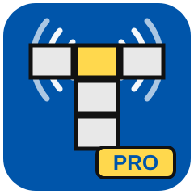
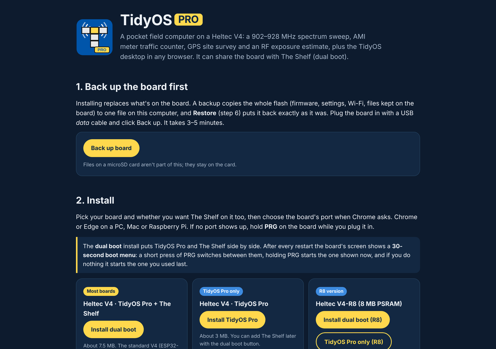

<p align="center"></p>

# Tidy Pro Plus for the Heltec V4

**Install: https://hardwaremack-prog.github.io/Tidy-Pro-Plus/** (Chrome or Edge, USB data cable)

Tidy Pro Plus is a copy of [TidyOS Pro](https://github.com/CharlesPhillips3/TidyOS-Pro) with a better web flasher:

- **Tick what you want copied**: TidyOS Pro, The Shelf, The Shelf's web app, the bootloader and the boot menu, each on its own.
- **See the free space as you tick**: a map of the board's 16 MB shows where each piece goes and how much is left
  (room for files, spare room for updates, and empty space), with the total free in big numbers.
- **Clean-up choices**: empty the slots you didn't tick, forget Wi-Fi and settings, or wipe either system's on-board files.
- **Pick TidyOS Pro's apps**: all 32, ticked one by one. That's the field tools, the everyday apps, and every app from
  [TidyOS-ESP32](https://github.com/hardwaremack-prog/TidyOS-ESP32) that TidyOS Pro had left out: Ready, Steady,
  Rugged, Latch, Games, Doodle, Pictures, Music, HTML Games and HTML Programs. Each one shows how much flash it adds.
- Quick picks for dual boot, TidyOS Pro only or The Shelf only, plus the original one-click buttons (those now install the full build, every app on).

### How the app picking works

TidyOS Pro is built twice: the **field build** (`tidyos-pro-<board>.bin`, 2.59 MB: the field tools and everyday apps) and
the **full build** (`tidyos-pro-<board>-full.bin`, 2.86 MB: every TidyOS app as well, built with `-DTIDY_ALL_APPS=1`).
The flasher uses the field build unless a TidyOS-ESP32 app is ticked. Before writing TidyOS Pro, it puts the ticked apps
into the image's app list (`TIDY_APP_LIST` in `core.cpp`) and fixes the image's checksum and SHA-256, so the board
accepts it. On its first start the board saves that list in its settings, so a Wi-Fi update keeps your choice.
Settings is always on the desktop. With more than 24 apps the desktop's icon rows get shorter so all 32 fit.

The flasher writes the pieces with esptool-js. They're in `firmware/parts/` (made by `tools/parts.py`, which `build.sh` runs
after `package.py`), and `parts.json` lists their sizes, where they go and the app list.
Version 3.1.2. Settings → Check for updates gets updates from this repo, **with or without a microSD card**.

### 3.1.2
- **Updates without an SD card**: with no card, TidyOS Pro saves the download in the board's own storage (the 7.4 MB
  `ffat` area The Shelf uses; it's set up first if it was never used, and needs about 3 MB free). The boot menu now
  looks for `/tidyos/update.bin` there as well as on the card, checks its SHA-256 and installs it.
  Boards from before 3.1.2 need one install from the web flasher with *TidyOS Pro* and *Boot menu* ticked.
- **Boot menu**: 10 seconds instead of 30, with the system used last already picked.
- The bottom bar shows the two kinds of free RAM separately: the chip's own and the PSRAM.

### 3.1.1 fixes (first run on a real V4)
- **Crash when opening apps** ("Stack canary watchpoint triggered" on core 0): the background tasks kept the stack
  sizes from the classic ESP32, and the S3 needs more. Every core-0 task now has about twice the stack.
  A new *stackwatch* task prints a warning on the serial port (115200) if any task gets within 700 bytes of the end of
  its stack, and a table of every task's spare stack 30 seconds after start-up.
- **Status light**: it was driving GPIO 2, which on the V4 is the radio's front-end enable, not an LED. It now uses the
  V4's white LED (GPIO 35). The V4-R8 has no LED free for it (GPIO 35 is its PSRAM), so there it stays off.
- Task Manager shows the PSRAM.

[](docs/screenshot-full.png)

*The install page ([full page](docs/screenshot-full.png)).*

TidyOS Pro turns a Heltec WiFi LoRa 32 V4 into a pocket field computer for 900 MHz and AMI work.
It's [TidyOS](https://github.com/hardwaremack-prog/TidyOS-ESP32) ported to the V4's ESP32-S3, with
tools for its SX1262 radio and GNSS module. The TidyOS desktop shows up in any browser on the same Wi-Fi.
It can also share the board with [The Shelf](https://github.com/hardwaremack-prog/The-Shelf-Heltec-V4900mhzMesh) (**dual boot**, with a 10-second boot menu on the OLED).

> Status: 3.0.0, first release. Everything builds for the V4 and V4-R8. It has **not been run on a board yet**,
> and the RF numbers haven't been compared with a calibrated instrument. Treat readings as indications until they have been.

## What's in it

| App | What it does |
|---|---|
| **RF Sweep** | Live 902–928 MHz spectrum: 129 channels of 200 kHz (902.2–927.8 MHz, the Wi-SUN/FAN plan Riva and most 900 MHz AMI meshes use). Average, peak and peak-hold traces, a waterfall, noise floor, busy threshold, an **OVERLOAD** warning, and a CSV export. Antenna gain, attenuator and front-end correction are set here. |
| **Meter Traffic** | *Whole band*: how busy each channel is (bar chart, busiest-channel list). *One channel*: a burst counter: bursts per minute, % of time on the air, burst-length histogram, latest bursts. It counts energy above the noise, so it works for OpenWay CENTRON (hw 2 / 3 / 3.1, ICM) and Riva alike. It doesn't decode or read anything. |
| **Site Survey** | GPS-tagged logging every N seconds to `SD:/rf/survey-*.csv` (time, fix, lat/lon, sats, noise floor, peak, busy %, band power density). Draws the points as a map coloured by noise / busy / peak, with "Mark here" notes, and exports **KML** for Google Earth. |
| **RF Exposure** | An **estimate** of power density against the FCC limits, from the band's readings: band average, the strongest moment, other units (µW/cm², W/m², V/m). Plus a calculator: transmitter power, duty cycle, gain, distance and count → mW/cm² and % of the limit. |
| **GPS** | Fix, position (decimal and DMS), altitude, satellites, HDOP, speed, UTC, and waypoints to `SD:/rf/waypoints.csv`. With no internet, the clock sets itself from GPS. |
| **Wi-Fi Scan** | 2.4 GHz networks: signal, channel, security, BSSID, and the quietest of channels 1/6/11. |
| **Clone** | Copies this board's firmware onto another V4 by wire (see below). |
| **The Shelf** | Restarts into The Shelf on a dual-boot board. |
| Nic Sweep, Ping, Tidy, Neat, Files, Calculator, Browser, Messages, Clock, Screenshot, Git-Store, Settings, Task Manager, Switches | From TidyOS. Tidy opens the CSV files the RF tools save. |
| Ready, Steady, Rugged, Latch, Games, Doodle, Pictures, Music, HTML Games, HTML Programs | From TidyOS, in the full build. Pick them in the flasher. |

**The desktop's right-hand panel** shows the time and weather, then **field conditions**, each with a 4-day graph (one point every 3 hours):
- **Wind and gusts** (mph, with direction) and **humidity** (with dew point)
- **Storms**: CAPE (how unstable the air is), with the hours the weather model had thunderstorms marked in red
- **Tropo ducting**: the refractivity gradient from the ground to the 925 hPa level, in N/km. About −40 is normal, −79 or lower is enhanced, and −157 or lower is a **duct**, when 900 MHz signals (meters, interference) carry much further than usual. Worked out from Open-Meteo's forecast model for your location.
- **Space weather**: solar flux (SFI), Kp with a 4-day bar graph, the GOES X-ray class, and an HF band estimate (the usual SFI/Kp rule of thumb)
- **NWS alerts** for your location (US)
- **This board's own** 900 MHz noise floor, band occupancy and GPS status, live
- A day/night **grey-line map** with a you-are-here marker

There's no free live lightning-strike feed a browser can read, so the storm graph uses the weather model's thunderstorm hours and CAPE instead.
The page in your browser looks all of this up (Open-Meteo, NOAA SWPC, api.weather.gov), not the board.

The top bar of the browser page has **Restart** (back to the boot menu) and **☾ Deep Sleep**. Deep sleep switches off the radio, its amplifier, the GPS and the OLED too; press **PRG** to wake it.

The board's **OLED** shows the desktop's address (or the setup hotspot and its password), the noise floor and the GPS status. It sleeps after 5 minutes; press PRG to wake it.

## How the exposure estimate works

The SX1262 reports the power at its input in dBm. Corrected for the front-end gain and any attenuator, that's the
power *P* the antenna picked up. An antenna of gain *G* has an effective area *Ae = G·λ²/4π* (≈135 cm² for 2 dBi at
915 MHz), so the power density of the wave that delivered it is *S = P / Ae*. RF Exposure sums every channel's
time-averaged power, and compares it with **FCC 47 CFR 1.1310** at 915 MHz: *f*/1500 = **0.61 mW/cm²** for the general
public and *f*/300 = 3.05 mW/cm² for workers (averaged over 30 minutes).

It's an estimate, good to a few dB. The antenna's real gain, the V4's own front-end (LNA) gain, direction,
polarisation and reflections all move it. The receiver also tops out a little below 0 dBm, so right beside a meter it reads
**low**: the apps say *OVERLOAD* when they see that. To calibrate it, compare with a known signal or a reference instrument,
then enter the difference as *Front-end dB* in RF Sweep. For a number you can sign off, use a calibrated broadband RF
exposure meter. For scale: a 1 W radio transmitting constantly gives ≈0.013 mW/cm² at 1 m (2% of the public limit), and AMI
radios transmit in short bursts.

## Hardware

| | Heltec V4 pins | Notes |
|---|---|---|
| GNSS module | GNSS header: RX 39, TX 38, EN 34, RST 42, WAKE 40, PPS 41 | Detected at start-up, 9600 or 115200 baud, either way round. |
| microSD (3.3 V SPI module) | **CS 4, MISO 6, CLK 47, MOSI 48**, 3V3, GND | Moved off 39–42 because the GNSS module uses them. With no GNSS module fitted, The Shelf's in-line wiring (CS 42, MOSI 41, CLK 40, MISO 39) also works. FAT32. |
| 900 MHz antenna | LoRa connector | **Receive only**: TidyOS Pro never transmits. |
| Clone cable (optional) | 43 → other board's RX, 44 ← its TX, GND (+ 3 → RST, 33 → GPIO 0 for auto reset) | V4-R8: no auto reset (GPIO 33 is its PSRAM). |

The V4-R8 (8 MB PSRAM) has its own builds. On the R8, TidyOS Pro leaves GPIO 33–37 and 40 alone.

## Dual boot

The flash is split so both systems fit (16 MB):

```
0x010000  menu    448 KB  TidyBoot: the boot menu, and the installer for updates
0x080000  tidyos    3 MB  TidyOS Pro
0x380000  shelf     2 MB  The Shelf (dual-boot build)
0x580000  www       2 MB  The Shelf's web app
0x780000  tidyfs    1 MB  TidyOS Pro's internal storage (when there's no card)
0x880000  ffat    7.4 MB  The Shelf's internal storage
```

Every start goes through **TidyBoot**. It shows *Start which one?* on the OLED for 10 seconds: a short press of PRG
switches, holding PRG for a second starts the one shown, and if you do nothing it starts the last one used. With only one
system installed it starts that one straight away, and waking from deep sleep goes straight back to the last one.
Each system sends the next restart back to the menu.

TidyBoot also installs updates. TidyOS Pro downloads its update to the microSD card, and The Shelf saves its update on the
card or in its internal storage. On the next restart TidyBoot checks the file and writes it into the right slot.
The dual-boot Shelf build (`source/ShelfDual`) is The Shelf 1.10.12 with three small changes, all behind
`SHELF_DUALBOOT`: it returns to the menu on restart, saves updates for TidyBoot to install, and uses the 4/6/47/48 card wiring.

**Back up first.** The web flasher's *Back up board* reads the whole flash into one file, and *Restore* puts it back
exactly as it was. That includes a backup made while the board only had The Shelf.

## Clone

Clone writes this board's bootloader, partition table, boot menu, TidyOS Pro and (optionally) The Shelf and its web app
onto another V4 through that board's ROM bootloader (the same protocol esptool uses). It runs at 921600 baud and checks every
piece with MD5. It doesn't copy settings, Wi-Fi passwords or files: the other board starts fresh, at the boot menu.

## Building

```
./build.sh
```

You need **arduino-cli** with the **esp32 core 2.0.17** (FabGL doesn't build on 3.x), and these libraries:
- **RadioLib 7.1.2**, **U8g2** and **NimBLE-Arduino 1.4.3**
- **ESPAsyncWebServer 3.3.23** and **ArduinoJson 7** (for The Shelf)
- `libraries/FabGL`, included here: FabGL 1.0.9 with TidyOS's patches and the ESP32-S3 port (see its README)

`build.sh` compiles TidyOS Pro, TidyBoot and the dual-boot Shelf for the V4 and V4-R8. It fetches The Shelf's web app
image from The Shelf's installer site, and `tools/package.py` writes `firmware/`, the install manifests, the updater manifests
(`manifest-pro*.json`) and `shelf/ota/` (what a dual-boot Shelf updates from).

Source map (in `source/TidyOSPro`):

| File | What's in it |
|---|---|
| `rf_engine.cpp` | SX1262 + front-end as a receiver, the sweep, one-channel listening, and the GNSS (NMEA) reader |
| `rf_apps.h` | RF Sweep, Meter Traffic, Site Survey, RF Exposure, GPS, Wi-Fi Scan, Clone UI, The Shelf switch |
| `clone.cpp` | The ESP32-S3 ROM-loader client for Clone |
| `oled.cpp` | The board's own screen |
| `desk_panel.h` | The desktop's right-hand panel, including the field conditions |
| `screen.cpp` | The browser page (and the JavaScript that fetches the weather, space weather and alerts) |
| `../TidyBoot/boot.cpp` | The boot menu and update installer |

Everything else is TidyOS 2.6.8. The rest of its notes (apps, printing, Git-Store and so on) are in the
[TidyOS README](https://github.com/hardwaremack-prog/TidyOS-ESP32#readme).

## Credits and licence

Based on TidyOS and The Shelf for Heltec. Uses [FabGL](https://github.com/fdivitto/FabGL) (GPL v3),
[RadioLib](https://github.com/jgromes/RadioLib) (MIT), [U8g2](https://github.com/olikraus/u8g2) (BSD-2),
ESPAsyncWebServer (LGPL-3) and ArduinoJson (MIT). The browser page uses data from Open-Meteo, NOAA SWPC and the US National Weather Service.
